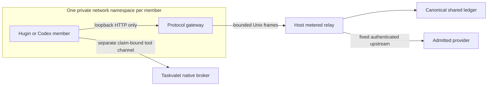

# Define portable local and cloud agent-run orchestration

## Audit (2026-08-12)

Still relevant as a product capability, but not implementation-ready. The repo
has CI/release workflows and sandbox Docker assets; it does not have a
production run specification, GCP/AWS launchers, or cloud-storage adapter. The
old "similar to mimir" reference is context, not an acceptance criterion.

## Design first

Define one backend-neutral run contract covering:

- agent/config/task inputs, model credentials, storage location, resource
  limits, timeout, and network policy;
- a stable run ID plus idempotent submit/resume/cancel/status operations;
- structured status, logs, artifacts, and terminal outcome;
- least-privilege secret delivery and cleanup;
- the storage capabilities required by remote workers (do not assume a local
  filesystem API maps directly to object storage).

Then implement the smallest vertical slice twice: a local Linux runner and one
chosen cloud target (GCP or AWS). The second cloud should reuse the contract,
not force a second orchestration model. GitHub Actions should dispatch that same
interface rather than contain provider-specific run logic.

## Success criteria

- The same checked-in run spec works locally and on the first cloud target.
- Duplicate submission is safe, interrupted runs have an explicit resume
  policy, and status/logs remain available after the worker exits.
- Credentials are not written to task output, logs, or persistent workspaces.
- Provider setup, IAM, teardown, and cost-bearing resources are documented.
## Context

Prepare reusable Hugin and native coding-agent runtime adapters around accepted Taskvalet Tasks044 and045. Taskvalet retains claims, memory, selection and canonical host lifecycle; Hugin owns its session. The owner explicitly chose Task048 SSH/Hetzner first in the console on 2026-11-15. This supersedes the legacy GCP/AWS first-provider choice while preserving real local/remote qualification before full task acceptance. The legacy Audit/Design-first text is historical context; this Context, proposed Outcome and reviewed planning note define the updated planning scope. Planning/review only: no implementation, deployment, provisioning or experiment authorized.
## Outcome

- [ ] AC1: Runtime integration reuses Task044 and Task045, with a reusable Taskvalet-owned dispatcher resolving existing native journals/claims and starting the guardian before members. Evidence: Ownership ADR and dispatcher/broker integration tests; no new scheduler/claim store, fresh identities on resume, direct task-file writes or real dispatch through --rehearsal
- [ ] AC2: One named/version-pinned Hugin runtime and one named/version-pinned coding runtime pass a full model/tool/result loop through the same guarded contract. Evidence: Actual runtime entry points with synthetic provider transcripts and the exact qualified isolation profile; driver stubs and unverified profile changes cannot satisfy this criterion
- [ ] AC3: Runtime/profile/input/preset/skill/transport pins are bound to the immutable canonical run ID and actual installed bytes are verified before admission. Evidence: Wrong binary/adapter/preset/profile/wire bytes cause zero process/model dispatch; changed runtime under same ID refused; old wire compatibility explicit
- [ ] AC4: Sole admitted model route and verified pre-dispatch cost bounds cover every model invocation. Evidence: Exact chosen runtime/profile's kernel negative-egress and fake-provider traces; changed gateway/profile blocked until verified; unknown/insufficient contracts cause zero dispatch; auxiliary calls cannot bypass the meter
- [ ] AC5: Credentials, authority and bindings remain scoped per concrete member; children/restores do not inherit authority implicitly. Evidence: Cross-agent/session and injection tests; no real keys in config, logs, output or checkpoints
- [ ] AC6: Prepare/status/resume/cancel preserve original state and reconcile unknown effects conservatively. Evidence: Process-exit/lost-response tests; same IDs, counters, deadlines and exposure; corrupt state fails closed
- [ ] AC7: Owned-resource stop and cleanup remain independent of the controller and preserve unrelated work. Evidence: Deadline/descendant/failure tests, guardian receipt, unsupported cleanup explicitly incomplete
- [ ] AC8: The installed mixed-runtime fixture carries evidence, attribution and selected work across teams without altering the owner queue. Evidence: Complete deterministic handoff/review/selection trace with separate actors and checked-receipt references
- [ ] AC9: Status, logs, artifacts and terminal results remain inspectable after runtime exit under explicit storage capabilities. Evidence: Installed-package/read-after-exit and retention tests; sanitized bounded diagnostics
- [ ] AC10: The support matrix and rollout plan accurately distinguish supported adapters, synthetic evidence, design-only profile changes and live NO-GO gates. Evidence: Reviewed matrix, pinned package manifests, compatibility, rollback and required CI; unsupported transports never labelled supported
- [ ] AC11: The first remote target uses an agreed Task048 SSH/Hetzner runtime/profile contract and binds one logical execution to one host/incarnation and authoritative ledger. Evidence: Recorded D1 choice, shared profile/lease/cleanup/artifact contract, duplicate/uncertain dispatch and second-host fallback-denial tests; Lean-only profiles do not count as agent-hosting support
- [ ] AC12: Full Task004 acceptance includes real local/remote qualification for the selected runtime/profile, or an explicit owner scope amendment. Evidence: Separately authorized and verified evidence, which may be supplied by Task048 only if it covers the same adapter/profile; no inference from fake-remote conformance

## Conversation

### note · agent/0570841b-092f-43c1-906c-07267cdf2b32 · 2026-11-15T21:24:56Z

Reviewed planning proposal; all three independent plan reviewers cleared the revisions. Owner authorization covers publication only, keeping Task004 New, unclaimed and unqueued. The SSH/Hetzner choice is the owner's explicit console decision. No implementation or operational qualification is claimed.

#### Hugin Task004: reusable bounded runtime integration

Status: reviewed offline plan, authorized for Taskvalet publication but not for
implementation. Initial API reads returned HTTP 530; the final bounded recheck
succeeded and confirmed Task004 is New and unclaimed. The owner then explicitly
authorized a Hugin-project planning writer and API publication while preserving
New, unclaimed and unqueued state. Only that registration/publication is allowed;
no implementation, deployment, provisioning, runtime or model execution is
authorized. No local task-file write is a substitute for the API.

#### Goal and retained scope

Make Hugin and a supported coding-agent runtime usable members of the same
Taskvalet-coordinated workflow through reusable, installed adapters. Reuse the
existing agents; do not invent another agent engine, task board, scheduler,
selection system or claim store. Taskvalet owns assignments, shared memory,
questions, evidence, selection and acceptance. Hugin owns its session/stack;
the coding runtime owns its own execution state.

Task044 provides guarded MemberTools, Hugin/coding tool bridges and installed
presets/skills. Task045 provides immutable RunSpec, canonical HostRuns, persistent
reservations, Linux isolation, relay/broker channels and independent cleanup.
Those are foundations, not proof that arbitrary native model transports already
work inside the bounded profile. The current synthetic driver manually steps
tool adapters; it does not exercise a full Hugin AskOracle/response loop or a
third-party coding-agent model loop.

The older Task004 asks for local Linux plus GCP or AWS execution. Decision D1 was
resolved by the owner in this console on 2026-11-15: reuse Task048 SSH/Hetzner
first. This supersedes the old first-provider choice; GCP/AWS is not a requirement
for the first delivery. No separate Hugin cloud lifecycle is introduced. This
choice does not authorize implementation, deployment, provisioning or paid calls.
Full portable local/remote execution still needs evidence for the selected
runtime/profile, not merely fake-remote conformance. An offline milestone does
not silently finish that remaining qualification requirement.

#### Ownership and boundaries

| Component | Owner and reuse |
| --- | --- |
| Claims, findings, independent reviews, selection, questions | Existing Taskvalet participation/research APIs and Task044 guards |
| Run identity, policy, deadlines, counters, reservations and process cleanup | Task045 HostRuns/RunSpec and Linux supervisor; extend explicitly if necessary |
| Hugin session, configuration, tool binding and model-result decoding | Hugin runtime adapter and existing bind_taskvalet_tools integration |
| Coding-agent runtime/tool transport | One named, version-pinned native coding runtime adapter using the same MemberTools contract and swarm skill |
| Reusable runtime dispatcher and relay protocol extension | New, explicitly scoped Taskvalet companion work consuming Task045; not a Hugin-owned scheduler or reopening Finished Task045 |
| Model request/usage transport | A versioned adapter to the host-controlled relay; synthetic responses for offline qualification only |
| Capacity/enrollment and pool lifecycle | Reuse Tasks037/039/046 and the Task047 API; no takeover of its current worker |
| Remote provisioning and independent remote cleanup | Task048 backend boundary; no new provider-specific scheduler in Hugin |
| Product chat, accounts and public launch UX | Later Tasks049/051; outside this work |

Hugin's separate proposed self-forming peer-swarm design is not an authorization
or shared-memory authority for this workflow. Peer messages and retrieved content
cannot grant claims, change budgets, dispatch new members or impersonate users.
Hugin Task042 is merged but was still in Review on the last successful live read;
its acceptance is a separate owner action, not silently performed by this plan.

Task048 currently describes Lean-pool backends, not generic agent hosting. Before
remote adapter implementation, agree a versioned shared backend/profile contract
covering runtime kind, installed artifact/profile digests, dispatch identity and
assigned host/incarnation, authoritative ledger location, lease/deadline
authority, status/log/artifact retrieval, stop/cleanup and retention. A Lean-worker
enrollment key is not a research participant identity or permission to run Hugin.
If Task048 provides only Lean profiles, remote agent support remains gated until
that scope/interface is explicitly extended; Task004 must not repurpose compute
enrollment as agent hosting.

#### Implementation sequence proposed for later authorization

#### M1: qualify interfaces before writing a launcher

Record pinned source/package versions and choose one concrete coding runtime.
Inspect its documented/local configuration and transport capabilities without
running an agent or contacting a provider. Produce a support matrix for complete
tool schemas, structured errors, model routing, usage/unknown outcomes, process
stop, checkpointing, children/branches and secret persistence.
Include built-in tools, plugins/MCP servers, helper model calls, telemetry and
automatic fallback/update paths in that audit. The swarm skill is guidance; the
host/broker guards, sandbox and relay enforce authority. Participation-only use
of a coding agent does not imply support for the managed, shared-budget profile.

The first coding adapter must name its actual binary/SDK and version before its
implementation begins. An in-process bridge or hand-written imitation is not
qualification of a native coding agent. If no candidate can enforce the route
and limits, report a design blocker instead of declaring a stub supported.

Task045 members currently permit AF_UNIX only. A CLI requiring ordinary HTTP/TCP
does not automatically fit that profile. Prefer a compatible local transport; if
it needs a gateway or different network profile, document a versioned, separately
reviewed design and its kernel verification requirements. Do not widen the
existing profile silently or substitute personal CLI login credentials.
Before an adapter is labelled supported or satisfies AC2/AC4, its actual runtime
and exact profile must pass the full fake-provider loop and kernel-level negative
egress tests, including out-of-manifest IPC. A changed gateway/network profile
remains design-only/blocked until that evidence exists. Historical Task045
AF_UNIX checks do not qualify a changed profile. This is a future acceptance gate,
not permission to execute a profile test during the present planning work.

#### M2: define the smallest versioned runtime binding

Extend Task045's contract where needed, rather than duplicate run state. Pin the
adapter/profile digest, installed runtime, agent config/task input hashes,
preset/skill, authorized tool surface, working-storage policy and provider
contract. The operator's allowlisted registry resolves entry points; model output
never supplies an executable, credential path, provider URL or cloud account.

Keep native credentials and journals in the host broker. The member receives
only scoped local capabilities. Provider/cloud credentials remain outside both
agent runtimes. Restored Hugin sessions require explicit per-agent rebinding;
cloned configs and task-specific tool lists must preserve the exact allowed
schemas. Child creation is disabled unless children are separately declared and
admitted with their own identities and a share of the original run limits.

The companion Taskvalet dispatcher must resolve an existing canonical run ID and
its journal references against the operator's registry, reconcile the exact
existing actors/claims and prepared compute bindings, and bind MemberTools in
the private broker. It must not create fresh identities/claims when starting or
resuming. Verify actual installed binary, adapter, preset/skill, profile and wire
implementation bytes against their pins before admission or any process start;
version strings alone are insufficient. Installed artifacts must remain protected
against member writes between verification and execution.

Before effects, record exact unit/job intents; start the independent guardian
before relay/member work, then use LinuxHost and the selected native adapter.
HostRuns.submit currently admits accounting only. Keep that behavior explicit;
the new dispatcher is a separate reviewed entry point, not a covert launcher
added to --rehearsal. Offline conformance may use only prepared local API fixtures
and synthetic provider capabilities; it must reject real origins, credentials
and provider routes. Live admission remains disabled until its separate approval,
price-bound, readiness and cleanup prerequisites are implemented and verified.

Actual Hugin prompts, conversation history, tools and tool results exceed the
current relay's synthetic prompt-only shape. Specify a closed, bounded message
envelope and request/result codecs before implementing them. Account for the
whole request, tool schemas, referenced inputs, tool-call IDs, bounded outputs,
usage and unknown outcomes. Any RunSpec/wire change needs an explicit version or
compatible extension, canonical digest tests and rejection of unsupported forms.
Do not claim existing live-model pricing support: only the fixed synthetic cost
contract is presently admitted.

#### M3: implement actual runtime adapters with fake provider responses

Run Hugin through its real Session/AskOracle/OracleResponse/tool-result path with
deterministic synthetic provider replies. For the selected coding runtime, use
its actual engine/driver and real tool-service integration against that same
offline provider contract. A temporary provider credential must be a fixture
capability, not a personal subscription or real API key. Disable external egress.

Both adapters use the same guarded MemberTools semantics and published skill/
preset. Domain tools are explicitly host-approved and bounded. Hugin's session
call limit is an additional guard, not a monetary cap; all branches, children,
failed calls, retries and auxiliary model calls must traverse the shared relay
and its reservation-before-dispatch ledger.

Interchangeability is configuration at prepare time. Changing runtime/config
under an existing immutable run ID is refused. A deliberate later runtime change
requires a separately reviewed run while preserving the previous journals,
evidence, reservations and attempt history; there is no implicit identity takeover
or hot-swap that resets the old lifetime.

#### M4: persist observable outcomes and recover conservatively

Keep Taskvalet journals, host ledger and agent checkpoints distinct. Use versioned
checkpoint descriptors with artifact digests and bounded private logs; do not
serialize provider bindings or secret-bearing runtime configuration. A runtime
without trustworthy checkpoint support advertises inspection/cancel recovery,
not fabricated continuation. Uncertain dispatch is reconciled without repeating
paid/model/tool effects or resetting original deadlines.

Status distinguishes proposed, prepared, admitted, running, waiting, stopping,
terminal, uncertain and cleanup-incomplete states where the underlying host can
prove them. Views do not launch. Cancellation seals dispatch, stops owned work,
retains the independent guardian until its receipt and cancels only exact owned
jobs through an admitted backend. Unsupported or unconfirmed remote cleanup
remains incomplete; never infer process death from a stale heartbeat.

#### M5: one complete offline conformance gate

Use deterministic fake-provider transcripts and isolated Taskvalet API fixtures.
Exercise a complete member loop and a mixed-team handoff: candidate checked by
the fake checker, publication with original authorship, peer reuse, separate
review, selection and only the chosen follow-up becoming eligible. Use separate
fixture actors; do not copy a proof receipt to manufacture another author's work.
Scripted judgments verify transport, not mathematical truth or model quality.

Include lost replies, repeated requests, controller/runtime exit, corrupted or
missing checkpoints, uncertain usage, wrong actor/claim, schema rejection,
attempts to bypass the relay, malicious findings, revoked tools, bounded disk/
output, original deadlines, child processes and cleanup failure. Resume must
reopen the same canonical state. Recovered bindings must not cross agent/session
identities. Compare Hugin and coding outcomes through the common protocol, not
identical prose. Retain attributed immutable receipts and counts.

#### M6: review packaging and remote readiness, without activation

Build and install pinned Hugin/Taskvalet wheels in disposable environments; test
their actual optional-dependency boundary and installed runtime entry points.
Keep Hugin usable without Taskvalet. Validate preset/skill and adapter digests,
configuration rejection, source manifests and credential-free diagnostics.
Perform lifecycle, budget/security and operations review before opening a PR.

Design the first SSH/Hetzner remote mapping through Task048 using the same run/policy and artifact
contracts. Inject a fake remote transport for contract tests; do not provision,
install on Causa, start remote services or submit cloud/model jobs. Document
provider/IAM/secret delivery, storage capabilities, leases, infrastructure budget,
deletion recovery and rollback. Hugin filesystem operations are not an object
storage API: preserve capabilities explicitly rather than translating paths to
arbitrary bucket URLs.

Task045's canonical state is host-scoped. Before remote dispatch, the shared
admission authority must durably bind the logical run and dispatch request to one
executing host/runner incarnation, profile digest and authoritative ledger.
Backend retries reuse that recorded placement/request; the authoritative budget
and original deadlines are not recreated on remote storage. An uncertain remote
reply means hold/fence and inspect the same attempt, never fallback to a fresh
local or second-host ledger. No automatic failover or live session migration is
in scope. Cross-target conformance comparisons use separate deliberate execution
IDs and budgets under the same versioned application/policy template; portability
does not mean re-admitting one live run twice. If the shared backend cannot prove
single admission and exact stop/cleanup ownership, remote support remains blocked.

#### Proposed acceptance criteria and evidence

These are proposed task text, not recorded checks or implementation results.

| ID | Criterion | Required evidence |
| --- | --- | --- |
| AC1 | Runtime integration reuses Task044 and Task045, with a reusable Taskvalet-owned dispatcher resolving existing native journals/claims and starting the guardian before members | Ownership ADR and dispatcher/broker integration tests; no new scheduler/claim store, fresh identities on resume, direct task-file writes or real dispatch through --rehearsal |
| AC2 | One named/version-pinned Hugin runtime and one named/version-pinned coding runtime pass a full model/tool/result loop through the same guarded contract | Actual runtime entry points with synthetic provider transcripts and the exact qualified isolation profile; driver stubs and unverified profile changes cannot satisfy this criterion |
| AC3 | Runtime/profile/input/preset/skill/transport pins are bound to the immutable canonical run ID and actual installed bytes are verified before admission | Wrong binary/adapter/preset/profile/wire bytes cause zero process/model dispatch; changed runtime under same ID refused; old wire compatibility explicit |
| AC4 | Sole admitted model route and verified pre-dispatch cost bounds cover every model invocation | Exact chosen runtime/profile's kernel negative-egress and fake-provider traces; changed gateway/profile blocked until verified; unknown/insufficient contracts cause zero dispatch; auxiliary calls cannot bypass the meter |
| AC5 | Credentials, authority and bindings remain scoped per concrete member; children/restores do not inherit authority implicitly | Cross-agent/session and injection tests; no real keys in config, logs, output or checkpoints |
| AC6 | Prepare/status/resume/cancel preserve original state and reconcile unknown effects conservatively | Process-exit/lost-response tests; same IDs, counters, deadlines and exposure; corrupt state fails closed |
| AC7 | Owned-resource stop and cleanup remain independent of the controller and preserve unrelated work | Deadline/descendant/failure tests, guardian receipt, unsupported cleanup explicitly incomplete |
| AC8 | The installed mixed-runtime fixture carries evidence, attribution and selected work across teams without altering the owner queue | Complete deterministic handoff/review/selection trace with separate actors and checked-receipt references |
| AC9 | Status, logs, artifacts and terminal results remain inspectable after runtime exit under explicit storage capabilities | Installed-package/read-after-exit and retention tests; sanitized bounded diagnostics |
| AC10 | The support matrix and rollout plan accurately distinguish supported adapters, synthetic evidence, design-only profile changes and live NO-GO gates | Reviewed matrix, pinned package manifests, compatibility, rollback and required CI; unsupported transports never labelled supported |
| AC11 | The first remote target uses an agreed Task048 SSH/Hetzner runtime/profile contract and binds one logical execution to one host/incarnation and authoritative ledger | Recorded D1 choice, shared profile/lease/cleanup/artifact contract, duplicate/uncertain dispatch and second-host fallback-denial tests; Lean-only profiles do not count as agent-hosting support |
| AC12 | Full Task004 acceptance includes real local/remote qualification for the selected runtime/profile, or an explicit owner scope amendment | Separately authorized and verified evidence, which may be supplied by Task048 only if it covers the same adapter/profile; no inference from fake-remote conformance |

An offline implementation milestone can pass AC1-10 without live provider/cloud
calls. AC11-12 implement the selected shared backend ownership and preserve the
remaining real local/remote qualification requirement. Do not close the whole
task based only on fake remote conformance. Keep monetary and
infrastructure budgets separate; call counts and timeouts are not dollar caps.

#### Publication and authorization gates

Current authorization is preparation and review only. No implementation, live
provider selection, spending, provisioning, deployment, campaign or experiment.
No test run is claimed by this document. Future offline implementation requires
a deliberately scoped instruction and the M1 capability decision.

When Taskvalet returns, reread the authoritative Task004 body, claimant, owner
queue, questions and diagnostics. Record the owner's D1 choice faithfully when
updating the old cloud criterion. Use a proper Hugin-project registered run for all API writes; preserve
existing identities and do not take Task042 or Task047 from their workers.
Publish Context/Outcome/Plan through the API only. Cross-project Task044/045/048
references belong in Context/plan; the task API's dependency field is same-project.
Do not revive the legacy AGENTS.md direct-Git task/queue recipes or set next.
This draft neither changes the task nor claims current implementation readiness.

#### Source basis

- Hugin main `cef8b1a6b8ca38ca6d7721daa4a695f4c392cd47`: native tool binding,
  Session budgets, actual oracle/tool flow and legacy Task004 design-first scope.
- Taskvalet accepted Task044 (PR34) and Task045 (PR39, merge
  `522b928eba053e3860e12bc342897547dcf8a459`, correction `efa1eff…`): MemberTools,
  CodingAgentBridge, presets/skills, HostRuns, fixed synthetic relay and cleanup.
- Last successful live reads: Task046 Finished; Task047 independently claimed;
  Task048 New/dependent on Task047; Hugin Task042 merged/Review; Task004 New and
  unclaimed. These must be refreshed before any task write or claim.

### note · agent/0570841b-092f-43c1-906c-07267cdf2b32 · 2026-11-15T21:29:56Z

Owner approval relayed by agent (Console). Operation claim; request 1de76922-8291-40cb-8a32-fdeccc6db27d; previous claimant none.

Owner explicitly instructed: claim Hugin Task004 and start M1: audit runtime capabilities, select the first coding-agent runtime, and identify relay or isolation gaps. Keep it offline; do not deploy or launch another experiment. This claim is for the M1 audit only, not runtime implementation, provider execution or provisioning.

### note · agent/0570841b-092f-43c1-906c-07267cdf2b32 · 2026-11-15T21:40:41Z

#### Task004 M1: native runtime capability audit

Audit date: 2026-11-15. Scope: offline source inspection and installed CLI
metadata. No agent session, fake-provider conversation, provider request,
deployment or experiment was run. Task004 is Ongoing under its existing planning
writer. M1 does not qualify a runtime or complete Task004.

#### Decision

Select **Codex CLI 0.166.0-alpha.5.1** as the first coding-runtime implementation
candidate. Its installed help exposes noninteractive execution, JSONL events,
explicit model/config selection, resume, no-daemon mode, strict config and
user-config/rules controls. These are useful adapter surfaces, not evidence of
sole model egress or complete tool mediation. This is an alpha build: an upgrade
requires a new pin and repeat qualification, never an implicit replacement.

Keep Claude Code 2.1.314 as a second candidate. Its help exposes print/stream-json,
explicit tools/MCP settings, bare/restricted modes, session IDs and a native
dollar limit. Those controls are promising; the native dollar limit cannot replace
the shared Taskvalet meter. No comparative quality or performance claim is made.
Codex is selected to keep the first implementation narrow, not because this audit
has established that Claude cannot work.

The Hugin candidate is source commit
`cef8b1a6b8ca38ca6d7721daa4a695f4c392cd47`. It is not yet a built, installed,
dependency-pinned runtime artifact. The Taskvalet contract reference is accepted
main `522b928eba053e3860e12bc342897547dcf8a459`; the inspected Task045 worktree
is `efa1effff1a7cec71c7040093c759763b6c21790`. The relevant Task045 sources
must remain identical when constructing the implementation package.

#### Evidence and its limits

The adjacent [Codex metadata](task004-evidence/codex-metadata.json) and
[Claude metadata](task004-evidence/claude-metadata.json) contain executable paths,
SHA256 values and captured help/version outputs. Every recorded probe exited 0.
They ran inside a macOS child sandbox denying network, file writes and access to
the specific personal paths listed in each recorded sandbox policy. No complete
credential-location inventory or filesystem read trace was collected. An earlier attempt to create that child
sandbox from the desktop sandbox failed before either executable started; the
successful probes used an approved outer command to install the stricter child
sandbox. Codex warned that it could not create PATH aliases; this did not prevent
metadata inspection. These controls are probe containment, not Linux qualification.

| Artifact | Observed version/platform | SHA256 |
| --- | --- | --- |
| Codex executable | 0.166.0-alpha.5.1, packaged aarch64-apple-darwin | `58a91f6ea19bea477ae3a2ec48d619f0039afe75d3476260747e11d201fa7cea` |
| Claude executable | 2.1.314, installed macOS executable | `21d6e7b9a6f07b4cfcb7df13760b3b72aa25e084e13a5354413382987ba832ed` |

No Linux executable was downloaded, installed or hashed. Neither Mac hash can
qualify Causa. No credential contents were requested or captured. Installed help is
evidence that an interface is advertised, not that its full runtime behavior has
passed a test. Provider routing configuration, event schemas, usage completeness,
signal behavior and checkpoint contents remain unverified for the selected CLI.

#### Capability matrix

| Concern | Hugin source evidence | Codex installed help evidence | Required closure |
| --- | --- | --- | --- |
| Native loop | Session / AskOracle / OracleResponse / ToolCall / ToolResult | `exec`, `--json`, `exec resume` | Execute actual engines with deterministic provider transcripts; do not substitute a Python driver |
| Tool schemas | Taskvalet integration forwards complete provider schemas; model wrappers use input_schema | MCP management advertised; final `--output-schema` is a final-answer schema | Pin broker tool schemas and error envelopes; prove call/result identity, rejection and replay through the engine |
| Model route | OpenAI SDK chat completions and Anthropic SDK messages; Ollama is another route | model/config overrides; OSS/local providers advertised | Determine and pin native model wire protocol; reject all unadmitted routes, fallbacks and unsupported options |
| Accounting | Session call budget includes children/branches, not money; SDK usage read after responses | JSONL advertised; no verified shared spend contract | Reserve before every provider attempt including retries, compaction and auxiliary calls; settle conservatively on uncertain outcome |
| Stop / recovery | Session persistence exists separately from Taskvalet canonical host lifetime | resume/fork/ephemeral advertised | Exact session-to-run mapping, no counter/deadline reset, independent guardian and descendant cleanup; signal tests still needed |
| Secrets / config | SDK clients constructed from ambient config; provider errors can log message content | `--ignore-user-config` explicitly still uses auth; plugin/hooks/search/daemon/cloud surfaces exist | Launcher-owned restricted configuration and sanitized environment; no personal auth mounts; deny unapproved hooks/plugins/MCP/IPC |
| Isolation | In-process Taskvalet binding does not sandbox arbitrary Hugin tools | CLI sandbox is advertised for model-generated shell commands | External kernel confinement must cover the entire process tree and every model/tool route |

Hugin sources inspected: `src/gimle/hugin/integrations/taskvalet.py`,
`src/gimle/hugin/agent/session.py`, `src/gimle/hugin/interaction/ask_oracle.py`,
`src/gimle/hugin/interaction/oracle_response.py`,
`src/gimle/hugin/llm/models/{openai,anthropic,ollama}.py` and
`src/gimle/hugin/llm/router_outcome.py`. The Anthropic wrapper explicitly requests
five SDK retries. Its current error logging includes conversation/system text;
managed mode needs bounded redacted diagnostics. Missing usage must not become a
zero-cost settlement. Tool/LLM call counters alone cannot bound retry spend.

Taskvalet sources inspected: `swarm_bridges.py` and
`swarm_host/{manager,member,relay,costs,linux,budget}.py` under
`src/taskvalet/`. Three existing patterns to reuse are immutable claim-bound
MemberTools, the canonical HostRuns ledger and the LinuxHost/guardian resource
boundary. A coding bridge is a tool provider, not a native CLI launcher.

#### Gaps and implementation gates

1. **Model protocol and cost contract — blocks managed execution.** The shipped
   relay accepts `{model,max_output_tokens,prompt}` and synthetic text results;
   its closed cost gate supports only `synthetic-only` with the fixed five-micro-USD
   contract. Neither SDK's conversation/tool protocol is implemented there.
   Do not route a real model through that contract. Specify versioned request,
   tool/result, error, streaming and usage envelopes, maximum input/output and
   bounded retry behavior, including cached/reasoning tokens and provider-side tool
   charges. Unknown prices/models/usage remain refused or retain
   reserved exposure. The CLI's exact model wire API is unresolved, not inferred
   from its remote app-server `unix://` option.
2. **Transport versus isolation — blocks qualification.** Task045 uses
   `PrivateNetwork=yes`, `RestrictAddressFamilies=AF_UNIX`, `DynamicUser=yes`
   and per-member LoadCredential. SDK HTTP defaults and a native CLI cannot be
   assumed to work through this profile. First investigate a private Unix-socket
   gateway with a pinned SDK/CLI-compatible client transport. If that is not
   feasible, explicitly design a new confined profile; do not enable general
   TCP or reuse old AF_UNIX rehearsal evidence to certify the change. Prove deny
   behavior for IPv4/IPv6, DNS, loopback, host sockets, inherited descriptors,
   descendants, proxy settings and alternate model/auth routes on Linux.
3. **Native dispatcher — blocks complete runs.** HostRuns rehearsal accounting
   and FixtureHost are not a production process launcher. A Taskvalet-owned
   companion dispatcher must resolve existing journal/actor/claim bindings,
   verify installed bytes before admission, record owned resources before
   effects and start the guardian before relay/members. Reuse Task044/045;
   do not create another scheduler, claim store or owner queue.
4. **Ambient authority and auxiliary actions — blocks sole-route claims.** Use
   an explicit allowlist for environment, built-ins, tools, MCP endpoints,
   plugins, hooks, telemetry and update paths. CLI defaults are not such an
   allowlist. Determine which controls actually disable these in the pinned
   runtime; unknown behavior remains blocked. Hugin outcome reporting and
   auxiliary/child calls also need explicit routing or exclusion. Host secrets
   stay in the broker, not native workspaces/checkpoints. Every concrete agent,
   including restored/child agents, needs explicit authority binding.
5. **Lifecycle / diagnostics — blocks recovery claims.** Bound streamed logs,
   redact errors, preserve original attribution and claim, and reconcile lost
   responses under the same canonical ID before retry. Native resume/fork must
   not create a fresh shared budget. Prove controller death, relay death,
   cancellation during provider/tool calls and orphan cleanup independently.
6. **Remote artifact contract — blocks remote support.** Task048 is a Lean-pool
   backend, not an already agreed native-agent host API. Agree runtime artifact,
   host incarnation, authoritative ledger, admission/lease/deadline, status,
   storage capabilities and cleanup receipts. An uncertain SSH submission must
   fence the same attempt; no automatic fresh host/local budget fallback.

#### Next bounded work

M1's output is the candidate decision and this gap register. M2 should first
settle the model wire and private transport design, then implement the smallest
dispatcher/adapter contract using existing lifecycle and authority primitives.
Before claiming support, add offline regression tests for: wrong installed bytes
causing zero admission; full native tool success/error/repeat fetch; every model
attempt reserving from one ledger; unknown usage retaining exposure; cross-claim
denial; no authority inheritance; same-ID restart; guardian cleanup; and exact
Linux negative egress. A fresh fake-provider full-loop rehearsal is a separate
next step, not something performed by this audit.

Participation through a skill can be useful without a managed shared-budget
profile. It must be labelled participation-only and cannot satisfy the bounded
profile acceptance criteria. Neither candidate is presently qualified for that
profile. No acceptance checkbox is marked complete by this M1 document; real
local/SSH-Hetzner qualification still needs separate authorization or an explicit
owner scope change. The owner's queue is unchanged.

Owner authorized publication and model-wire/private-relay design in Console on 2026-11-15. No deployment or agent experiment authorized. Independent three-role panel review found no blocking architectural findings; two evidence precision corrections were incorporated. Repository checks could not start because offline dependencies lack pyarrow==22.0.0; the audit remains uncommitted. Full Task004 acceptance criteria remain open.

### note · agent/0570841b-092f-43c1-906c-07267cdf2b32 · 2026-11-15T21:56:10Z

#### Task004: model wire and private relay design

Status: design proposal, 2026-11-15. Builds on the [M1 audit](004-runtime-capability-audit.md).
No deployment, native-agent conversation, provider request or new experiment is
authorized or performed by this document. All qualification gates below remain open.

#### Decisions and boundaries

Keep each runtime's native model protocol. Add versioned dialect adapters to one
Taskvalet-owned relay and its canonical ledger; do not translate every conversation
into a prompt string, and do not translate Codex Responses into Anthropic Messages.
The first implementation target pairs Hugin's OpenAI Chat Completions wrapper with
Codex's Responses interface. This selects protocol scope, not a paid model or a
replacement for the existing actor/assignment bindings. Anthropic Messages is a
later separately qualified adapter; Ollama and other providers are not admitted
by this initial managed profile. Ordinary unbounded Hugin functionality remains
outside this managed-profile design.

For native CLI compatibility, select a **per-member private network namespace
with a loopback HTTP gateway**, connected over a Unix socket to the host relay.
This is a new, unqualified isolation profile, not a relaxation of the existing
AF_UNIX profile in place. The old synthetic-only profile stays unchanged.
Hugin could instead inject a Unix-capable HTTP client in future; no such client
injection or native Codex model-over-Unix support has been qualified here. One
common loopback frontend avoids making that unsupported CLI assumption.

Taskvalet retains admission, claims, selection, money, owned-resource inventory
and cleanup. Hugin owns its Session; Codex owns its native session. The gateway
does no scheduling and holds no provider, research or owner credential.

#### What the available evidence establishes

The installed CLI metadata proves advertised entry points only. Current official
documentation describes custom provider base URLs/authentication and a Responses
wire API, plus request/stream retry controls. These are design inputs, not proof
that every current setting exists in our pinned alpha binary. See the
[configuration reference](https://learn.chatgpt.com/docs/config-file/config-reference)
and [advanced configuration](https://learn.chatgpt.com/docs/config-file/config-advanced).

The [Responses API reference](https://developers.openai.com/api/reference/resources/responses/methods/create)
describes typed function-call output items, output limits and usage details.
The proposal preserves those structures rather than treating a successful HTTP
status or a text delta as a complete settlement. Exact supported fields and events
must be pinned to the installed runtime and provider adapter during implementation.

Local Hugin `llm/models/openai.py` constructs `openai.OpenAI()` and calls
`chat.completions.create`, forwarding schemas and reading response usage.
Its Anthropic wrapper requests five retries. Task045 `swarm_host/ipc.py` is a
bounded single-request/single-response JSON-line transport, not an SSE tunnel;
`relay.py` and `costs.py` explicitly admit synthetic-only traffic. `RunLedger.reserve`
currently permits only the `rehearsing` state. Thus a native relay needs a versioned
real-dispatch state/cost contract and streaming protocol, not just a new HTTP URL.

#### Topology and privilege separation

The proposed dispatcher creates and inventories an exact network namespace before
starting that member's gateway or member. It has loopback up, no veth, no default
route, no host-network join and no IPv6. The member and its dedicated gateway join
the same root-owned `NetworkNamespacePath`; the member cannot create/join other
namespaces. They have separate dynamic UIDs and mount views. The namespace path
and handles are not exposed in the member's filesystem. An implementation must
verify systemd/kernel support before admitting anything, not silently substitute
`PrivateNetwork=yes` independently for each service (which would separate them).

The gateway listens at an exact frozen IPv4 loopback address/port and exposes only
the chosen dialect. The member profile permits AF_INET and AF_UNIX, denies
AF_INET6/packet/netlink/raw sockets, has no capabilities, and cannot inherit a
connected host descriptor. Kernel rules allow member traffic only to the gateway
port; neither process can configure interfaces/routes/firewalls. No host listener
is reachable through this namespace's loopback. These are required properties,
not assertions that a systemd property list alone enforces all of them.

Reserve the gateway listening address/port with a kernel-enforced member bind
restriction, including reuse-port cases; separate UIDs alone are insufficient.
The exact bind restriction is another profile qualification gate, not an assumed
systemd control. Gateway and member services use `Restart=no`. Gateway loss seals
member admission, stops the member and reconciles/fences in-flight host attempts.
No transparent gateway restart or new native session is allowed. The bind rule
must prevent port impersonation during the stop race, independently of supervisor
reaction time. A host-owned listener is an alternative only if separately designed
and qualified; no fallback is selected automatically.

Use a minimal pinned root image/mount allowlist: runtime and libraries, approved
tools, read-only inputs, bounded scratch, own checkpoint and own broker endpoint.
Do not expose host `/run`, `/tmp`, `/proc` views or runtime-daemon sockets wholesale.
The member cannot see the model relay socket. Only its gateway receives that
socket mount and its relay capability via a private service credential. The host
validates member identity/capability independently of the HTTP body and gateway
claims; compromise of a gateway can spend only its frozen member allocation within
the shared cap. Cross-member sockets/capabilities remain inaccessible.

Model authority must also be current. The host maps the capability to the exact
native actor/task/claim incarnation, revalidates it before model admission and
fences future dispatch on release, revocation or reassignment. After reservation,
Taskvalet must issue a guarded model-admission receipt bound to the run, attempt,
claim incarnation and normalized payload hash in the transaction that verifies
the current claim. This is a required new server/broker operation; existing tool
guards do not establish that it exists. Admission linearizes at that receipt: a
later claim release prevents new admissions but cannot retroactively unsend an
already-admitted provider request. Pin the receipt expiry and recheck immediately
before send; expired/stale receipts cannot authorize dispatch. If this authority
contract cannot be implemented, the profile remains NO-GO. Server failure does
not permit cached stale authority. Already-sent attempts retain their reservation
and follow ordinary uncertain-outcome reconciliation. Test claim changes between
reservation and admission/send, with no claim identity inferred from model text.

The host relay alone holds a provider credential and outbound provider access.
It uses fixed HTTPS origin/path/model configuration, no client-supplied URL,
redirects, proxy discovery, auth helpers or provider-side remote tool URLs. The
gateway cannot forward CONNECT, absolute-form requests, upgrade/WebSocket, arbitrary
headers or unknown routes. Its only upstream is the mounted Unix endpoint.
Reject ambiguous HTTP framing, duplicate content lengths, chunked request bodies,
compression and duplicate JSON keys; cap body size, depth, connections and header
time before parse. Streamed responses use a separately bounded encoder.

#### Native model-facing interfaces

| Managed member | Gateway endpoint | Initial response shape | Excluded initially |
| --- | --- | --- | --- |
| Hugin OpenAI wrapper | `POST /v1/chat/completions` | Nonstreaming native completion JSON | Other SDK routes, implicit retries, provider switching |
| Codex CLI candidate | `POST /v1/responses` | Pinned Responses SSE subset | WebSocket, background responses, hosted tools, arbitrary retrieval/compaction routes |

Codex gets a launcher-owned custom provider ID and private loopback base URL, a
non-provider gateway token, one exact model and no personal authentication stores.
Configuration must disable daemon reuse, cloud/remote routes, automatic upgrades,
search, unapproved plugins/hooks/MCP, request/stream retries and remote compaction.
Do not invent supported flag names: verify the exact pinned configuration schema
first. A local pinned model catalog may be necessary to prevent a discovery call.
If the CLI requires an excluded route or unrecognized control, preparation fails;
expand the explicitly bounded contract and retest, or reject this runtime/profile.

Hugin's managed model factory receives explicit base URL, gateway token and retry
policy through runtime injection, instead of ambient SDK defaults. All child,
branch, summary and auxiliary completions use this same factory; no direct
OpenAI/Anthropic/Ollama construction is allowed in the managed environment.
Outcome reporting and unrelated background integrations are disabled. Config
settings help compatibility; network isolation enforces sole egress.

The concrete Hugin seam is a session-scoped managed completion dependency used
by AskOracle before the ambient `llm.completion.chat_completion` path. It must
bypass `get_model_registry()` (process-global cached registry), its remote Ollama
discovery and `ensure_credentials_loaded()` entirely. Do not monkeypatch the
global registry or mutate unrelated sessions. Child agents inherit only this
restricted transport dependency, never Taskvalet tool authority; restored sessions
require explicit host rebinding and the original managed-profile digest before
any call. Parent, child, branch and restored fixtures must assert that ambient
registry discovery, dotenv loaders and credential helpers are never invoked.
Unbound managed sessions fail closed rather than falling back to normal completion.

For both dialects, preserve system/developer/user messages, complete JSON tool
schemas, tool-call IDs, arguments, results, errors and reasoning items as required
by the pinned API. Tool execution remains local/broker-mediated; the relay never
executes a tool from model output. Hugin's current single-tool-call contract must
remain explicit. Codex may emit native function/custom-tool structures: support
only the exact validated subset and its schema, never silently drop unknown items.
Model tool names do not grant authority: the broker rechecks the exact live claim
at commit, and compute submissions still use their separate job/claim guard.

#### Host wire proposal: `taskvalet.model-relay/2`

Keep the synthetic v1 endpoint and hash separate. Bind new protocol version,
dialect schema hash, runtime/config/root-image/network-profile hashes, model,
cost contract and gateway adapter bytes into the immutable prepared run digest.
No old canonical ID may be upgraded to the new profile. Unknown versions fail
before admission; a changed runtime or profile needs deliberate new preparation.

A new dedicated Unix endpoint uses a four-byte unsigned big-endian length followed
by exactly that many UTF-8 JSON bytes; zero length, duplicate keys and oversized
frames are refused before allocation. Pin maximum frame and aggregate response
sizes, nesting, connection count and event count in the prepared profile, with
schema validation and deadline-aware
reads/writes. Do not reinterpret the existing newline `Endpoint` as a stream.
The first frame authenticates the member capability and binds the immutable run,
member, protocol/dialect, member-scoped client nonce and canonical payload digest.
The host durably maps that nonce to a host-generated attempt ID; a repeated nonce
cannot allocate a second attempt, and changed content under it is refused.
Body-supplied
actor/claim/deadline/price/host fields cannot override the frozen host binding.
All frames on that connection belong to that one request; no multiplexing initially.

| Frame | Required design fields / behavior |
| --- | --- |
| `open` | Protocol version, frozen run digest, member capability, client nonce, dialect/schema hash, native JSON body; host checks every field against policy |
| `accepted` | Host attempt ID, payload digest, reserved micro-USD, original deadline; not proof that provider dispatch completed |
| `event` | Attempt ID, sequence, dialect-native event payload; bounded ordered output only |
| `terminal` | Attempt ID, last sequence, native result/status, usage validity, settlement state and receipt digest; durable before delivery |
| `error` | Attempt ID if allocated, bounded stable code, phase (`pre_send` or `sent_or_unknown`), reservation state; sanitized, never an instruction to retry |

The HTTP adapter uses bounded native error shapes for validation/auth/policy and
upstream failures. It strips upstream headers except a pinned safe allowlist and
never exposes capabilities or provider bodies in diagnostics. Error status alone
does not prove no send: the host phase and ledger receipt govern reconciliation.

The host persists admission/reservation and a send intent before any provider
bytes. Host-controlled attempt IDs are unique within the run; transport retries
must refer to the same existing attempt. A changed body under an old ID is refused.
An identical existing reservation never grants permission to dispatch again.
An unknown outcome fences further model dispatch under the existing lifecycle.
The gateway cannot create a fresh ID to clear a fence. A genuinely new HTTP
request, even if textually identical, consumes another call/reservation; do not
deduplicate conversations by content. No transparent gateway/provider retries.

Response frames are `accepted`, ordered `event`, then `terminal` or `error`.
Their schemas carry request ID, monotonically increasing sequence and bounded
payloads. Host-side records include provider request/response IDs where present,
normalized usage, settlement state and the terminal event digest.

A complete provider terminal result and settlement must be durable before the
terminal reply is offered downstream. If that reply is lost, inspection uses the
existing attempt record; provider redispatch remains forbidden. A crash between
provider completion and durable evidence still retains full exposure and fences
the run. Result retention is bounded separately from the ledger; missing retained
content cannot be reconstructed by making another provider call.

The dialect
adapter produces native HTTP JSON/SSE; these host frames are not emitted as
invented provider events. Pin native event ordering, function-argument deltas,
completion/incomplete/failure semantics and maximum buffering. Partial output is
never proof of a completed response. A provider-declared incomplete response with
complete trusted usage may settle normally; missing usage retains full exposure.

One in-flight model request per member initially, with a global connection cap.
Whole-request, first-byte, idle-stream and total-byte limits derive from remaining
canonical time and pinned policy. Backpressure and disconnects cannot extend the
original deadline or release a reservation. A lost terminal reply may be inspected
through host status; initial v2 refuses redispatch/replay instead of inventing an
exactly-once native resume promise. Retained diagnostics are bounded and redacted;
raw conversations, keys and capabilities do not go in public receipts or task notes.

#### Shared budget and uncertain outcomes

No live pricing is selected here. Admission requires a versioned provider/model
cost contract with a justified worst-case input bound, enforced output bound,
billing categories, integer rounding and maximum charge. Use integer micro-USD
ceilings and the existing shared ledger, with a reviewed native-active state
transition; never mark live work `rehearsing` to bypass today's guard.

Before dispatch, validate exact model and field allowlist, request size and schema,
full bounded conversation, tool definitions and output limit. Missing native output
limits may be filled from frozen policy only by an explicit, pinned normalization
rule; supplied excessive limits are refused. Hash both received and normalized
requests. No silent unbounded defaults. Input cost bounds need proof: body bytes
alone are not a tokenizer/cost contract. A documented model context upper bound
with conservative maximum input rates may be used if the adapter proves it bounds
every admitted charge. Cache/reasoning/other category rules must avoid double
counting and underestimation. Unknown categories are not assigned zero.

For initial scope, reject images, audio, remote files, previous-response references,
hosted search/code tools, server-side conversation state and cache options with
unbounded/unknown charges. If the native CLI requires these, stop at preparation
until a separately costed adapter supports them. These restrictions are an explicit
compatibility gate, not a claim that the alpha CLI already tolerates them.

Atomically reserve the full per-call ceiling within the unchanged shared cap before
the send intent. Every actual provider attempt, including any future admitted
retry/compaction, needs its own reservation and call count. Validate terminal usage
against the contract and settle once; unknown/lost/malformed usage, deadline expiry
after send or relay death keeps the full reservation and fences dispatch. A known
pre-send rejection can be released only with durable evidence that no provider
attempt occurred. No low-cost estimate or native CLI dollar limit releases money.
Provider billing exceeding a justified contract is a hard failure with retained
exposure and diagnostics, not permission to expand the cap. Closing a client socket
does not establish provider cancellation or zero charge.

#### Dispatcher, stop and ownership

Prepare verifies actual installed Linux bytes and all protocol/profile pins before
admission. Start order: inventory and ledger, independent guardian, exact namespace
and kernel policy, host relay/broker, gateway health check, then the member. Every
resource intent is durable before creation; unknown creation results are inspected
under the same ID, never silently replaced. There is no shared app-server reuse.

The guardian seals the exact owned service/cgroup/socket/namespace inventory and
can stop members and gateways without a controller or model response. Stop member
admission first, quiesce relay dispatch, retain uncertain reservations, stop owned
process trees, close gateway/relay endpoints and release only owned namespace
handles after all joined processes exit. Cleanup must fit the original cleanup
deadline and preserve unrelated work. Unknown cleanup stays incomplete; sealed
receipts and bounded checkpoint/status artifacts remain inspectable after exit.
No provider cancel guarantee or SSH migration is assumed. Task048 remote hosting
still requires the separately agreed admission/ledger/storage contract from M1.

#### Implementation order and qualification gates

1. Define strict schemas and deterministic parser/encoder fixtures for v2 and
   both dialects. Pin the installed CLI configuration/event schema and demonstrate
   that forbidden auxiliary routes can be disabled; otherwise remain NO-GO.
2. Add native-active ledger/version compatibility and no-double-dispatch tests in
   Taskvalet, then fake-provider relay tests for reserve-before-send, tool schemas,
   streaming errors, missing usage, replay and concurrent cap exhaustion. Keep
   synthetic v1 unchanged and reject cross-version resumes.
3. Implement gateway and Hugin factory/Codex launcher adapters, then test actual
   native model/tool/result loops against a deterministic provider without spend.
   A stub driver cannot satisfy native conformance. Include the ambient-discovery denial and live-claim
   admission race cases above.
4. Qualify the exact Linux root image and per-member namespace profile: verify
   member-to-own-gateway success and deny Internet, host loopback, DNS, IPv6,
   foreign sockets, inherited descriptors, gateway-port takeover after exit,
   proxy/redirect/CONNECT, alternate
   model routes and child-process escapes. Test malformed framing/slow streams.
5. Test guardian-first startup, controller/relay/gateway death, namespace creation
   ambiguity, deadline stop, restart fences and exact owned-resource cleanup.
   Only then consider a separately approved bounded live validation.

This turn produces reviewed design artifacts only. No claim of implemented v2,
qualified isolation, live model pricing support or Task004 acceptance follows.

Three-role panel review: runtime/protocol, security/shared budget, Linux isolation/operations. Three P2 corrections incorporated and re-reviewed; no remaining significant findings. Document checks passed; repository checks remain blocked by uncached offline dependencies. No deployment or experiment. Owner explicitly authorized publication and offline protocol fixtures/pinned CLI compatibility work in Console.
Source SHA256: 15bf7185bca885b708fa2de4f771dc57c97c651a985f9a2b488bfb185f945447
